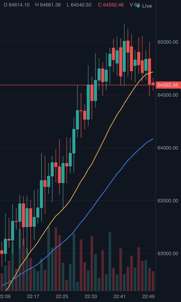
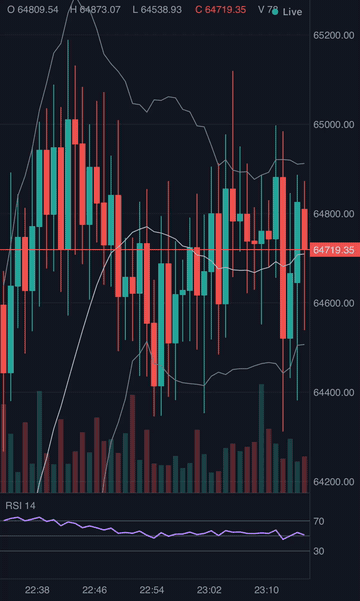
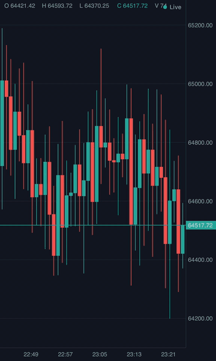
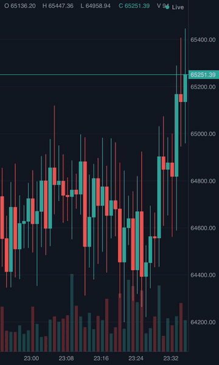
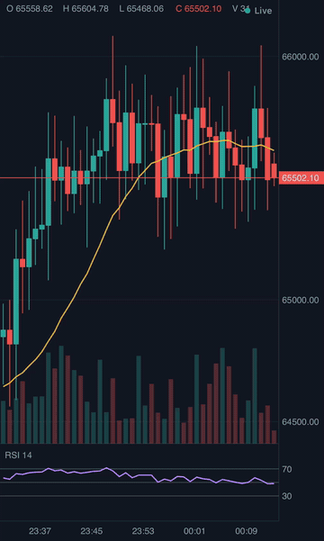

# Chartston

> GPU-accelerated, New-Architecture-first **candlestick charting** for React Native & Expo — Skia + Reanimated + Gesture Handler.

[](https://www.npmjs.com/package/chartston)
[](https://github.com/VladSkoromnyi/chartston-rn-expo/actions/workflows/ci.yml)
[](./LICENSE)

Chartston draws interactive financial charts on the GPU and keeps everything that moves **off the JS thread** (Skia rendering + Reanimated worklet gestures). It targets the **New Architecture** (Expo SDK 56+ / RN 0.79+) and ships exchange-style candlesticks, overlays, oscillator panes, a long-press crosshair, live streaming, theming, and basic drawing tools.

> **Status: pre-release (`0.x`), active development.** The public API is close to stable but may still shift before `1.0`.

<p align="center">
  
</p>

## Features

- **Chart types** — candlestick, bar (OHLC), line, area, baseline.
- **Buttery navigation** — pan, pinch-to-zoom (focal-anchored), and flick momentum, driven by UI-thread worklets.
- **Crosshair & legend** — long-press snaps to the nearest bar with a synchronized OHLCV legend and a last-price tag.
- **Live streaming** — time-keyed `snapshot` / `append` / `patch` updates (active-bar tick vs. new bar), with no whole-series flicker.
- **Lazy history** — scroll back toward the start and older candles page in automatically (via the adapter's `endTime`), keeping your viewport in place.
- **Built-in studies** — SMA, EMA, WMA, Bollinger, RSI, MACD, ATR, Stochastic, VWAP — plus **custom studies** via a declarative `StudyDescriptor`.
  - Price-pane **overlays** (SMA / EMA / Bollinger / VWAP) + a faint **volume** histogram behind the candles.
  - **Oscillator sub-panes** (RSI, MACD) that share the x-axis.
- **Annotations** — `markers`, `priceLines`, and trend / horizontal **drawings** in data coordinates (they track pan & zoom).
- **Theming** — dark / light out of the box via a fully-typed `ChartTheme`; linear or **log** price axis.
- **Any data source** — implement a 2-method `MarketFeedAdapter`; a **Binance** reference adapter is included.
- **States** — loading / empty / error (with retry) + a live connection-status chip.
- **TypeScript-first** — strict types are a feature, not an afterthought.

## Demo

| Crosshair & legend | Studies & panes | Chart types & themes | Lazy history |
|---|---|---|---|
|  |  |  |  |

<sub>Recorded on the iOS Simulator from the dev app's Demo tab with a synthetic, deterministic feed. Regenerate with [`scripts/make-gif.sh`](scripts/make-gif.sh) — see [docs/media](docs/media/README.md).</sub>

## Requirements

Chartston is **New Architecture only**. Peer dependencies:

| Package | Version |
|---|---|
| `react` | `>= 19` |
| `react-native` | `>= 0.79` |
| `@shopify/react-native-skia` | `>= 2` |
| `react-native-reanimated` (+ `react-native-worklets`) | `>= 4` |
| `react-native-gesture-handler` | `>= 2.31` |
| `@gorhom/bottom-sheet` | `>= 5` *(optional — only for the bundled selector sheets)* |

## Installation

```sh
npx expo install chartston @shopify/react-native-skia react-native-reanimated react-native-worklets react-native-gesture-handler
# optional, for the selector sheets in `chartston/ui` (PeriodSelector / SymbolSelector / IndicatorMenu / ChartTypeSelector):
npx expo install @gorhom/bottom-sheet
```

Then:

1. Add the Reanimated worklets Babel plugin **last** in `babel.config.js`:
   ```js
   module.exports = (api) => {
     api.cache(true);
     return { presets: ['babel-preset-expo'], plugins: ['react-native-worklets/plugin'] };
   };
   ```
2. Wrap your app in `GestureHandlerRootView` (and `BottomSheetModalProvider` if you use the selectors).

## Quick start

```tsx
import { GestureHandlerRootView } from 'react-native-gesture-handler';
import { Chart, BinanceFeedAdapter, type SymbolInfo } from 'chartston';

const feed = new BinanceFeedAdapter();
const symbol: SymbolInfo = {
  id: 'BTCUSDT', base: 'BTC', quote: 'USDT', exchange: 'binance',
  displayName: 'BTC / USDT', pricePrecision: 2, qtyPrecision: 5, type: 'spot',
};

export default function App() {
  return (
    <GestureHandlerRootView style={{ flex: 1 }}>
      <Chart symbol={symbol} interval="1m" adapter={feed} />
    </GestureHandlerRootView>
  );
}
```

## Bring your own data

The only thing a feed must do is implement `MarketFeedAdapter` — two methods:

```ts
import type { MarketFeedAdapter } from 'chartston';

class MyFeed implements MarketFeedAdapter {
  name = 'my-feed';

  async fetchHistory(req) {
    // return Candle[] (time in epoch ms, ascending)
  }

  subscribe(req) {
    // call req.onUpdate({ type: 'append' | 'patch', candle }) on each tick,
    // req.onStatus('open' | 'reconnecting' | ...) for the status chip,
    // and return an unsubscribe function.
    return () => {/* cleanup */};
  }
}
```

Time is canonical **epoch milliseconds (UTC)** everywhere; adapters convert at the edges.

## Studies, theming & annotations

```tsx
<Chart
  symbol={symbol}
  interval="1m"
  adapter={feed}
  theme={DARK_THEME}                 // or LIGHT_THEME, or your own ChartTheme
  chartType="candlestick"            // 'bar' | 'line' | 'area' | 'baseline'
  activeStudies={{ overlays: ['sma', 'ema', 'vwap', 'volume'], panes: ['rsi', 'macd'] }}
  priceLines={[{ price: 65000, title: 'target' }]}
  markers={[{ time: 1719600000000, shape: 'arrowUp', text: 'buy' }]}
  drawings={[{ kind: 'horizontal', price: 64000 }]}
  logScale={false}                   // logarithmic price axis
  onCrosshairMove={(bar, index) => {/* … */}}
  onViewportChange={(v) => {/* offset, barSpacing, pinnedToNow… (throttled) */}}
/>
```

### Custom studies

Ship your own indicator with a `StudyDescriptor`: `compute` turns candles into
series, `draw` paints them with Skia. Overlays map against the price axis; panes
stack below the built-ins and autoscale to the study's visible values.

```tsx
import { Skia } from '@shopify/react-native-skia';
import type { StudyDescriptor } from 'chartston';

const momentum: StudyDescriptor = {
  id: 'mom10',
  kind: 'pane', // or 'overlay'
  name: 'MOM 10',
  inputs: { period: 10 },
  compute(c) {
    const out = new Float64Array(c.length).fill(NaN);
    for (let i = 10; i < c.length; i++) out[i] = c.closes[i]! - c.closes[i - 10]!;
    return { series: { mom: out }, scratch: {}, lastIndex: c.length - 1 };
  },
  draw(ctx, s) {
    const path = Skia.PathBuilder.Make();
    for (let i = ctx.startIndex; i <= ctx.endIndex; i++) {
      const v = s.series.mom![i]!;
      if (!Number.isFinite(v)) continue;
      const [x, y] = [ctx.indexToX(i), ctx.valueToY(v)];
      path.countPoints() ? path.lineTo(x, y) : path.moveTo(x, y);
    }
    const paint = Skia.Paint();
    paint.setColor(Skia.Color('#00bcd4'));
    paint.setStyle(1); // stroke
    paint.setStrokeWidth(1.5);
    ctx.canvas.drawPath(path.detach(), paint);
  },
};

<Chart /* … */ studies={[momentum]} />;
```

`compute` receives its previous state while the data only ticks or grows, so a
study can recompute just the tail from `prev.lastIndex`; after a symbol switch or
history prepend it gets none and starts over. A study that throws is skipped.

### Drop-in controls

The selector sheets live in the `chartston/ui` subpath, so the core package has no
`@gorhom/bottom-sheet` dependency. They need `@gorhom/bottom-sheet` + a
`BottomSheetModalProvider`:

```tsx
import {
  SymbolSelector,
  PeriodSelector,
  IndicatorMenu,
  ChartTypeSelector,
  ThemeSelector,
} from 'chartston/ui';
```

## How it compares

| | Chartston | `react-native-livechart` | `kline`-style (WebView) |
|---|---|---|---|
| Renderer | Skia (native GPU) | SVG / RN views | HTML canvas in a WebView |
| New Architecture | ✅ first-class | partial | n/a |
| Gestures off JS thread | ✅ Reanimated worklets | ❌ | n/a |
| Live streaming contract | ✅ snapshot/append/patch | limited | varies |
| Built-in indicators | 9 | few | many (but in WebView) |
| Pluggable data adapter | ✅ | ❌ | ❌ |

*(Comparison is best-effort as of writing; see each project for current capabilities.)*

## Roadmap

Pre-1.0 and moving quickly — see [CHANGELOG.md](CHANGELOG.md). Recently: custom studies, log scale, viewport callback, reconnect gap fill, and a rendering path that holds 60 fps at 50k candles with every study on.

Next: a physical-device performance pass, then toward 1.0. Later: an in-chart drawing toolbar, a docs site, more feed providers, replay export.

## Contributing

- [Development workflow](CONTRIBUTING.md#development-workflow)
- [Sending a pull request](CONTRIBUTING.md#sending-a-pull-request)
- [Code of conduct](CODE_OF_CONDUCT.md)

## License

MIT © [Vlad Skoromnyi](https://github.com/VladSkoromnyi)
